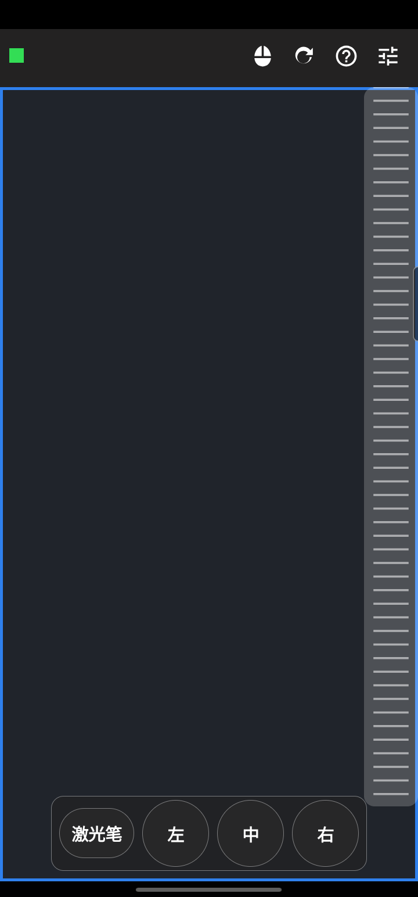
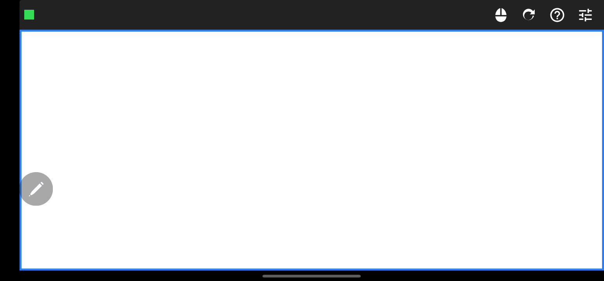
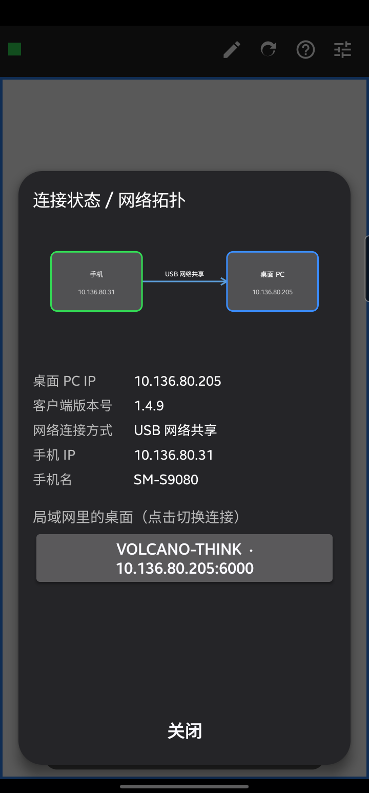
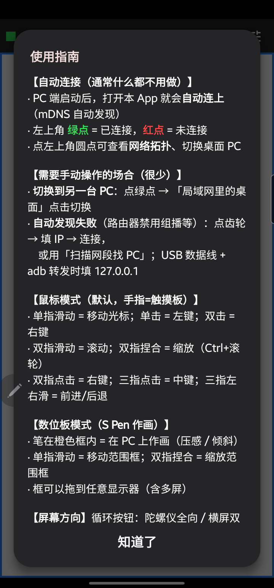
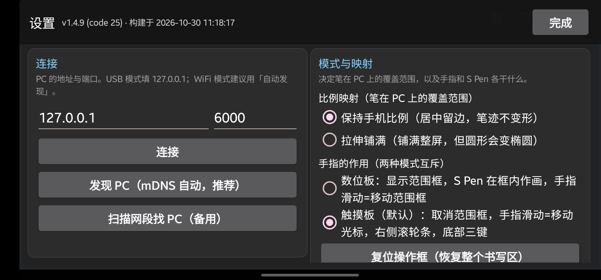

# SpenTablet —— 把旧三星 Note + S Pen 变成 PC 数位板 & 触摸板

把闲置的三星 Note 手写笔手机，变成 Windows PC 上的**压感数位板**和**多点触摸板**。  
手机与 PC 通过局域网 / USB 实时通信，打开即用，零配置。

> **零操作上手**：PC 端启动后，打开手机 App 就会**自动连上**（mDNS 自动发现），  
> 左上角**绿点 = 已连接**。默认是触摸板模式——手指当触摸板，立刻能用。

| | |
|---|---|
|  |  |
| 主界面只有一行：绿点 + 四个图标，书写区最大化 | 横竖屏都支持，陀螺仪自动翻转 |

---

## ✨ 功能亮点

- **压感数位板**：S Pen 带压感 / 倾斜，直接在 Photoshop / Krita / SAI 里作画
- **触摸板模式（默认）**：手指 = 笔记本触摸板——右侧**浮动虚拟滚轮条**（双击切无极滚动）、
  底部**可拖动浮动面板**（激光笔 + 左/中/右键合并，按键触发会闪烁提示）、双指滚动、
  **双指捏合缩放**（触摸板缩放 API 优先，不支持时自动降级 Ctrl+滚轮）、三指/四指四方向手势，
  动作全部可配（含音量加减、静音、任务前后切换）
- **桌面激光笔**：触摸板模式一键把 PC 指针变成**激光光斑**（白热核心 + 彩色光晕），指哪照哪不留痕迹，长按换色（黄/绿/粉/蓝）
- **桌面备注**：S Pen 直接在 PC 桌面**固定坐标**画笔迹（透明置顶、鼠标穿透），**每一笔记住自己的颜色**（换色只影响之后的笔），撤销一笔 / 长按清空
- **桌面捕获**：一键把 PC 范围框画面设为**手机画布背景**，在上面继续书写绘画
- **主界面一键切换**：图标即状态——触摸板图标 = 触摸板模式，笔图标 = 数位板模式，点了就切
- **零配置连接**：mDNS 自动发现，连 IP 都不用填；USB / 热点 / WiFi / VPN 各种网络环境都能连
- **网络拓扑可视化**：点绿点看拓扑图——连接方式、PC IP、客户端版本号、手机 IP，一目了然（整页可滚动）；  
  局域网里有多台 PC 时点击即可切换
- **应用内检查更新**：直接比对 GitHub Releases 最新版本，有新版弹窗提示更新内容，
  确认后自动下载 APK 并拉起系统安装；启动时也会静默检查（仅发现新版才提示）
- **跨屏范围框**：桌面上橙色框=可作画区域，可以拖到**任意显示器**（多屏），双指捏合缩放
- **陀螺仪方向**：跟随（四向）/ 横屏双朝向 / 竖屏双朝向，三种模式一键循环
- **独立设置页**：IP / 比例 / 模式 / 增益 / 触摸板配置 / 版本信息 / 检查更新，按返回键即关

## 🖼 功能实机一览

### 网络拓扑（点左上角绿点）

拓扑图直观显示「手机 ↔ 桌面 PC」与连接方式；下方是 IP、版本号等详细信息；  
局域网里的其它桌面**点击即切换连接**。



### 使用指南（右上角问号）

内置操作指南：自动连接说明、两种模式的手势、PC 端下载链接（可点击直接打开浏览器）。  
**按当前模式排序**：触摸板模式先显示触摸板手势、数位板模式先显示数位板章节；  
触摸板的手势清单会**实时显示当前生效的动作配置**（设置里改完，指南里同步更新）。



### 设置页（右上角齿轮）

连接地址、mDNS 发现、比例映射、模式切换、压感增益……底部有**版本信息**与  
**检查更新 / 项目主页**快捷入口，按返回键关闭。



---

## 🚀 快速开始（三步）

1. **PC 端**：从 [Releases](https://github.com/volcanochen/drawing-phone/releases/latest)  
   下载 `SpenTabletHost-win64-*.zip` 解压运行 `SpenTabletHost.exe`（自包含单文件、免安装、托盘常驻）；  
   或自行编译：`cd PcHost && dotnet publish -c Release` → `publish/SpenTabletHost.exe`  
   > 首次运行会请求一次**管理员权限**（UAC）。原因：前台程序若以管理员身份运行（WorkBuddy 就是），
   > Windows 会拦掉普通权限进程的鼠标注入，表现为「指针在这一窗口上完全动不了」。
   > 不想提权可加参数 `--no-elevate`，届时托盘会提示并在菜单里提供一键提权重启。
2. **手机端**：从 Releases 下载 `SpenTabletPhone-*.apk` 安装；  
   或 Android Studio 打开 `PhoneTablet/` 目录自行构建
3. **连上就用**：PC 和手机连同一网络 → 打开 App → 绿点亮起 → 完成！  
   手机横过来当触摸板，掏出 S Pen 直接画画

> 手机没有和 PC 在同一网络？用 **USB 数据线**连接 + `adb forward tcp:6000 tcp:6000`，  
> App 里填 `127.0.0.1` 即可（usb0/RNDIS 网卡会自动识别为 USB 网络共享）。

## ✋ 两种操作方式（主界面一键切换）

主界面右侧第一个图标就是**当前模式的实时状态**：

- 🖱 **触摸板图标 = 触摸板模式（默认）**：手指是笔记本触摸板
- ✏️ **笔图标 = 数位板模式**：S Pen 在桌面橙色框内作画，手指负责移动 / 缩放框

| 手势    | 触摸板模式          | 数位板模式     |
| ----- | ------------- | --------- |
| 单指滑动  | 移动光标          | 移动桌面范围框   |
| 单指单击  | 左键            | —         |
| 单指双击  | **双击**（左键 ×2，不再是右键） | —         |
| 双击不松手再拖 | **按住左键拖动 = 拖拽 / 框选文字**（同笔记本触摸板） | —         |
| 双指滑动  | 平滑滚动（像素级，横竖向） | —         |
| 双指捏合  | 缩放（触摸板缩放 API 优先，不支持时降级 Ctrl+滚轮，可配置） | 缩放范围框 |
| 双指点击  | 右键（可配置）       | —         |
| 三指点击  | 中键（可配置）       | —         |
| 三指左/右/上/下滑 | 后退 / 前进 / 中键 / 左键（各自独立可配置） | — |
| 四指点击  | 切换模式（可配置）     | —         |
| 四指左/右/上/下滑 | 各自独立可配置（默认：无 / 切模式 / 音量+ / 音量-） | — |
| S Pen | **不响应**（光标只归手指，笔碰屏幕/悬停都无效） | 压感 / 倾斜作画 |

触摸板模式专属 UI（**都是浮动控件，进设置页、拓扑页、指南页时自动隐藏**）：

- **右侧虚拟滚轮条**：带横纹、滑动即滚动，高度不越过书写区；**双击在「普通滚动 / 无极滚动」间切换**，  
  无极模式抬手后继续滚 **3 秒**缓出停下（动量倍率可配 0.2~3.0，1.0 = 3 秒），**再次按下立即打断**
- **底部可拖动浮动面板**：**激光笔 + 左 / 中 / 右键**合并在一个面板里，挡住画面就按住面板任意位置
  整体拖走（位置记住，转屏按比例还原）；任何一个键被**点击或被手势触发**都会**闪烁高亮**，
  手势打中了哪个键一眼可见
- **激光笔**：点「激光笔」开启后 PC 指针变成激光光斑（醒目光点，鼠标穿透、不留痕迹），
  长按换颜色（黄 → 绿 → 粉 → 蓝），再点一下关闭。**所有位置都保持激光图标**：
  文本输入框的 I 型、链接的手型、等待/忙等一律换成激光笔，演示时不会一进输入框就变回文字光标；
  唯一例外是光标被应用隐藏的场景（全屏游戏等），保持隐藏不强拉出来

触摸板底色可在设置里换（暗灰 / 纯黑 / 深蓝 / 墨绿 / 酒红）。

触摸板手感：手指位移**横纵同速**（统一按书写区高度归一化）、逐帧补全 Android 的合并采样点、  
不足 1 像素的位移跨帧累积，所以慢速移动也跟手、不会丢步或突然跳一下。

触摸板状态的**防卡死**设计（三层）：
1. 手机上「一根手指都不剩」的结束类事件（UP / CANCEL / POINTER_UP）强制复位手势状态并补发
   「手指已离开」——否则笔还按在屏上时最后一根手指抬起，会让状态卡在非零，之后笔怎么动都不响应；
2. App 回到前台（`onResume`）先清一次手势中间态，兜住锁屏/切应用吞掉的事件；
3. PC 端「笔让位」标志 4 秒没收到手指事件就自动解除；心跳里比对「手机已发鼠标帧数 vs PC 实收」，
   差超过 100 帧判定链路半死，主动断开让手机重连。

**手势死区**（设置页可调，0 = 关闭）——让手势"起步更稳"，不再被手抖干扰：

| 死区 | 默认 | 作用 |
|---|---|---|
| 移动死区 | 8 dp | 手指按下后累计位移超过它才开始驱动**光标 / 滚动 / 拖框**，手抖不误触 |
| 捏合死区 | 15 % + 10 dp | 双指跨度变化要**同时**超过相对与绝对阈值才算捏合，**微小的捏合不会抢走双指滑动**；捏合中途回到起点会交还给滑动 |

切换会**实时同步 PC**：数位板模式桌面显示范围框，触摸板模式自动取消范围框。

## 🖍 数位板模式浮动面板（备注 / 撤销 / 预览 / 截屏 + 色板，可拖动）

数位板模式下屏幕底部浮出一个面板，**按住面板任意位置可整体拖走**（挡住画笔区域就挪开，位置会记住）；  
进设置页 / 拓扑页 / 指南页时自动隐藏：

- **备注 / 画笔**：按钮文案就是**当前模式名**，点一下切换
  - **备注**（默认）：S Pen 在 PC 桌面画笔迹——**每一笔落笔即锁定桌面绝对坐标**，之后移动 / 缩放范围框，  
    已有笔迹**留在桌面原位置、不跟着拉伸**（透明置顶窗口、鼠标穿透，不影响正常操作），适合网课 / 会议标注
  - **画笔**：原来的非备注模式，笔迹**只画在手机上**，桌面不受影响；
    而且手机屏上的笔画会**按时间自动淡出消失**（默认 6 秒，手机当草稿纸用），
    所以这个模式下**撤销和预览按钮会隐藏** —— 笔画本来就会自己没，撤它没意义
  - 选择会记住（`noteOn`）；**每次连上 PC 都会把备注状态完整同步一遍**——  
    否则 PC 端重启后 `_noteOn` 归零、手机又因为"本来就已经是开"而不补发，  
    就会表现为「捕获正常但笔迹只画在手机上、桌面什么都不出」
  - **捕获是备注之上的附加能力**：捕获后笔迹照样同时输出到桌面，两者互不影响
- **笔迹颜色**：面板下排 7 个预设色（红/橙/黄/绿/蓝/紫/白），点一下即切换。  
  **颜色是对「某一笔」生效**——换色只影响之后落的新笔，已画的笔保留各自颜色；**手机屏上的笔迹同步换色**；  
  选择会记住并在连上时同步给 PC
- **撤销**：点击**手机屏与桌面各撤一笔**，**长按两边一起清空**
- **预览 / 完成**（原「捕获」）：把 PC 范围框内的画面**设为手机画布背景**（不弹新窗口），背景之上可以像白底一样继续书写绘画；  
  预览后按钮变成**完成**，再点一下即清除背景、解除范围框锁定
- **截屏**：把「范围框画面 + 桌面笔迹」合成一张 PNG 保存 —— **存到电脑**（默认 `图片库\SpenTablet`，
  可在配置里改 `ShotSaveDir`）和 / 或**传回手机存进相册**（`Pictures/SpenTablet`，图库里直接看得到）。
  范围和两个保存位置都能在手机设置里单独开关
- **笔悬浮提示**：S Pen 悬停在任意按钮上（不接触屏幕）会弹出该按钮的功能说明，移开或真正按下即收掉  
  （自绘气泡，不依赖系统 `tooltipText`——那个要 API 26，本项目 minSdk 21）

## 🖥 桌面上的范围框

- 橙色框 = S Pen 能覆盖的桌面区域，与手机书写区**宽高比恒定一致**（笔迹不变形）
- **单指滑动 = 移动框，双指捏合 = 缩放框**（以手指为中心锚点，焦点内容不跑位）
- 框可以移动到**屏幕的任何位置**，包括第二块、第三块显示器（按整个虚拟屏幕钳制）
- 手机端书写区永远撑满画布，可操作范围最大

## 📡 连接与拓扑

- 打开 App **自动连接**：先试上次地址，同时静默 mDNS 发现，找到唯一 PC 直接连上
- **PC 托盘图标即连接状态**：手机连上后图标**变绿**、悬停显示「已连接手机」，断开恢复蓝色「未连接」
- **绿点 / 红点**：主界面左上角圆点即连接状态；点击弹出**网络拓扑**：
  - 拓扑图：「手机」↔「桌面 PC」，连线上标注连接方式（USB 网络共享 / WiFi 局域网 / 局域网 / USB+adb）
  - 详细信息：桌面 PC IP、**客户端版本号**、连接方式、手机 IP、手机名  
    （版本号 / 计算机名 / 候选 IP 由 PC 在握手后经 `TYPE_INFO (0x0C)` 帧下发）
  - 「局域网里的桌面」：mDNS 发现的其它 PC，**点击切换连接**
- 连不上？设置页有「发现 PC（mDNS）」和「扫描网段找 PC」两道保险；手机 IP 与连接方式自动识别

## 🧭 屏幕方向

主界面循环按钮三态，全部**依赖陀螺仪、无视系统旋转锁**：

1. **跟随**（`fullSensor`）：四个朝向随陀螺仪实时翻转
2. **横屏**（`sensorLandscape`）：两个横屏朝向自动翻转，不会转成竖屏
3. **竖屏**（`sensorPortrait`）：两个竖屏朝向自动翻转

旋转时连接不断（Activity 不重建），PC 端按新的书写区宽高比自动重算映射区域。

## ⚙️ 设置页

- **连接**：PC IP + 端口（支持手动 / mDNS 发现 / 扫描网段三种方式）
- **比例映射**：保持手机比例（推荐，笔迹不变形）/ 拉伸铺满
- **模式**：数位板 / 触摸板（与主界面按钮联动）
- **复位操作框**、**悬停转发开关**、**压感增益**（0.5~8）
- **触摸板配置**：光标速度（0.2~3.0，默认 **1.5**）、滚动比例（0.2~**30**，默认 **5.0**）、  
  **手势死区**（移动死区 0~30dp 默认 **8**；捏合死区 0~60% 默认 **15** + 0~40dp 默认 **10**）、  
  **13 个手势槽**逐个自定义（双指滑动 / 双指捏合 / 双指点击 / 三指点击 / **三指上下左右滑** /  
  四指点击 / **四指上下左右滑**，可选动作含左中右键、后退前进、缩放、**音量加减、静音、下一 / 上一任务**、  
  切换模式、无操作）、右侧滚轮条滚动模式与无极动量、触摸板颜色五选一
- **版本信息**：手机端版本 + PC 端版本（拓扑页也可看）；「检查更新」**直接比对 GitHub Release、
  有新版可直接下载安装**，「项目主页」直达浏览器

## 🔍 调试

主界面不再显示调试文字（保持极简），全部改为**后台定量循环日志**：

- 文件：`Android/data/com.volcano.spentablet/files/spen_debug.log`
- 每 2 秒一条统计（连接 / 书写区 / 范围框 / 发送丢弃帧数），事件按 300ms 节流
- 单文件超 256KB 自动轮转 `.old`，总占用恒定 ≤ ~512KB

---

## 架构

```
手机 (Android, Kotlin)                      PC (Windows, .NET 8)
┌──────────────────────┐   TCP 6000        ┌──────────────────────┐
│ PenCanvasView        │ ──PEN/MOUSE帧──▶  │ TcpPenServer          │
│  (S Pen + 手指手势)   │ ──HELLO/RESET──▶  │  ↓ 坐标映射            │
│ NetClient (自动重连)  │                   │ MappingConfig         │
│ MdnsDiscovery (NSD)  │ ◀─INFO(版本/IP)── │  ↓                    │
│ TopologyDialog       │                   │ PenInjector (WTI压感)  │
└──────────────────────┘                   │ MouseControl / mDNS   │
                                           └──────────────────────┘
```

二进制协议：每帧 = 2 字节 magic + 1 版本 + 1 类型 + 2 长度（大端）。  
上行帧：HELLO(0x05) / PEN(0x01~04) / MOUSE(0x07) / PAN(0x06) / MODE(0x08) / RESET(0x0A) / NOTE(0x0D) / SHOT_REQ(0x0E) / HL(0x10)…  
`NOTE (0x0D)`：`action` = 0 关 / 1 开 / 2 撤销 / 3 清空 / **4 换色**，`arg` = 笔迹坐标分量或**颜色索引**（仅 action=4 用）。  
`HL (0x10)`：激光笔开关 + 颜色索引（0 黄 / 1 绿 / 2 粉 / 3 蓝），PC 端以注册表替换 Arrow 光标实现；
低级鼠标钩子 + 10ms 定时器把当前光标**持续贴回激光图标（所有位置，含编辑框的 I 型）**，
唯一例外是光标被应用隐藏时保持隐藏。  
`MOUSE (0x07)` 动作码：0 移动 / 1 左键按下 / 2 左键抬起 / 3 左键点击 / 4 右键 / 5 滚轮 / 6 缩放 / 7 中键 /  
8 后退 / 9 前进 / **10 音量+ / 11 音量- / 12 静音 / 13 下一任务 / 14 上一任务 / 15 手指落放 / 16 左键双击**。  
> `16 左键双击` 单独占一个码：PC 端用**一次 SendInput** 发 下-上-下-上，拆成两次单击会被系统判成两次独立点击。
上行还新增 `SAVE_REQ (0x11)`（截屏保存：`范围 / 存电脑 / 存手机` 三个 float），
下行用 `SAVE (0x12)` 分片回传 PNG（格式与 `SHOT` 相同）。
下行帧：INFO(0x0C) = `ver=…&name=…&ips=…`（URL-encoded UTF-8）；SHOT(0x0F) = PNG 分片（totalLen + seq + data ≤60KB，手机端重组）。  
HELLO payload 28 字节（7 个 float）：`surfaceW, surfaceH, aspectMode, workMode, frameL, frameT, frameScale`  
——最后三个是范围框状态，PC 断线重连后还原同形状同位置的框。

### 鼠标模式实现要点（触摸板手感）

- 多指事件整体处理；**只有单指移动光标**；触摸板模式下 S Pen 完全不参与（接触/悬停都不发，光标只归手指）
- 抬指后需在事件里排除残留手指，否则质心算错 →「松手光标跳一大段」
- 滚动发**非 120 倍数**的高分辨率滚轮增量 → Windows 按像素平滑滚动
- 双指跨度相对变化 > 12% 判定为捏合，否则滚动（手抖不误触）；回单指时重置基准点

## 目录结构

```
SpenTablet/
├── docs/img/               # README 实机截图
├── release/                # 各版本发布说明（二进制发到 GitHub Releases）
│   ├── v1.1.0/RELEASE_NOTES.md
│   ├── v1.3.0/RELEASE_NOTES.md
│   └── v1.3.1/RELEASE_NOTES.md   # 当前版本
├── tests/                  # 自动化回归（发布门禁：python tests/release_gate.py）
│   ├── README.md           # 测试套件说明：覆盖范围/运行方式/用例清单/FAQ
│   ├── protocol_smoke.py   # 协议级冒烟测试：模拟手机连 host，16 项端到端断言
│   └── release_gate.py     # 发布门禁：单测 + PC 编译 + 冒烟全绿才允许发布
├── PhoneTablet/            # Android 端（Android Studio 打开此目录）
│   └── app/src/main/java/com/volcano/spentablet/
│       ├── Protocol.kt        # 二进制帧编解码（含 INFO/NOTE/SHOT/HL 帧）
│       ├── NetClient.kt       # TCP 长连接 + 自动重连 + 下行帧接收（截图分片重组）
│       ├── MdnsDiscovery.kt   # mDNS/NSD 自动发现 PC
│       ├── NetworkScan.kt     # 兜底：扫描网段找 PC / 识别连接方式与手机IP
│       ├── PenCanvasView.kt   # S Pen 捕获 + 触摸板手势 + 手机屏画轨迹
│       ├── UpdateChecker.kt   # 检查更新：比对 GitHub Release + 下载 APK + PackageInstaller 安装
│       ├── UpdateReceiver.kt  # 接收安装结果，拉起系统安装确认界面
│       ├── GestureDeadZone.kt # 手势死区：移动死区闸门 + 捏合判定（纯 Kotlin，可单测）
│       ├── TrackpadState.kt   # 触摸板状态复位判定（纯 Kotlin，可单测）
│       ├── DebugLog.kt        # 后台调试日志（定量落盘 + 循环轮转）
│       ├── TopologyDialog.kt  # 连接状态 / 网络拓扑对话框（整页可滚动）
│       └── MainActivity.kt    # 界面/连接/设置/拓扑/指南/触摸板UI/工具条
└── PcHost/                 # PC 端（.NET 8，Win32 P/Invoke + mDNS 广播）
    ├── Program.cs / TrayApp.cs      # 托盘常驻入口
    ├── ConfigForm.cs                # 设置窗口（连接/输入/映射/显示 + 实时诊断）
    ├── PenInjector.cs               # 合成笔注入（压感/倾斜）+ 鼠标回退
    ├── MouseControl.cs              # 触摸板模式：光标/滚轮/按键/触摸板捏合缩放注入
    ├── HighlighterOverlay.cs        # 激光笔：光标替换 + 激光笔迹置顶窗口
    ├── NoteOverlay.cs               # 桌面备注：透明置顶穿透窗口画笔迹
    ├── TcpPenServer.cs              # TCP 帧解析 + INFO 下发 + 截图捕获下发
    ├── MdnsAdvertiser.cs            # mDNS 广播 _spentablet._tcp
    ├── MappingConfig.cs             # 坐标映射 / 虚拟屏幕钳制 / 模式
    ├── RegionFrame.cs               # 桌面操作范围框（可穿透点击）
    ├── NetInfo.cs                   # 网卡枚举 / USB共享识别 / 防火墙
    └── publish.cmd                  # 发布自包含单文件 EXE
```

根目录 `test_protocol.py`：直连 127.0.0.1:6000 模拟手机发帧，可验证模式切换、  
范围框显隐、光标位移与左右键。

## 前置条件

- PC：Windows 10/11 + .NET 8（单文件发布版自带运行时，免装）
- 手机：Android 8.0+，三星 Note 系列最佳（S Pen 压感依赖）

## 排错

| 现象               | 处理                                             |
| ---------------- | ---------------------------------------------- |
| 红点连不上            | 设置页点「发现 PC（mDNS）」；不行再「扫描网段找 PC」                |
| USB 连接           | `adb forward tcp:6000 tcp:6000`，IP 填 127.0.0.1 |
| PC 收到帧但没笔迹       | 确认绘画软件窗口在前台；用托盘菜单的调试浮窗验证笔数据                    |
| 防火墙拦截            | PC 端首次运行会自动添加 6000 端口规则，被安全软件拦时手动放行            |
| VPN / 多网卡导致连错 IP | PC 端日志会列出全部候选 IP；拓扑页可核对实际连接地址                  |
| **指针在某些窗口上完全动不了**，切到别的窗口又正常 | 该窗口是**以管理员身份运行**的（如 WorkBuddy）。Windows 的 UIPI 会静默丢弃低权限进程的鼠标注入。右键托盘 →「以管理员身份重启」；或启动时接受 UAC（默认会自动提权）。加 `--no-elevate` 可跳过提权 |

> 「指针冻住」这条在日志里能直接看到证据：`[Guard] 指针注入失效：…；前台：WorkBuddy (pid …, 管理员权限)`。

## 已知限制 / 后续可加

- 压感依赖 Windows RealTimeStylus/WTI，个别绘图软件需切换 Wintab 模式
- 后续可加：二维码配对、多手机同时连、安卓端压感曲线调节

## 参考

- [Windows Pen Injection (WTI)](https://learn.microsoft.com/windows/win32/tablet/) · [NSD/mDNS](https://developer.android.com/develop/connectivity/wifi/nsd) · 虚拟屏幕坐标 `SM_XVIRTUALSCREEN`
